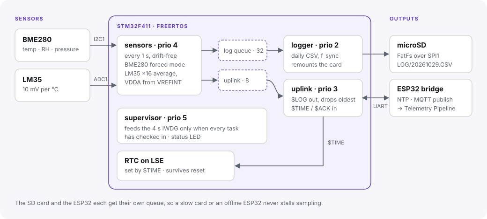
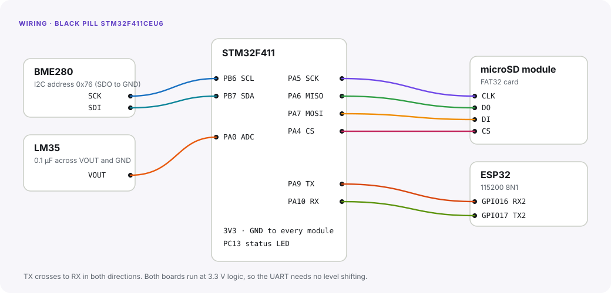

# STM32 Environmental Logger

[](https://github.com/Asmodeus8/stm32-logger/actions/workflows/build.yml)

FreeRTOS firmware for an STM32F411 that reads a BME280 (temperature, humidity, pressure) and an LM35 (temperature) every second. It logs each reading as a CSV row on a microSD card and streams it over UART to an ESP32, which publishes it over MQTT. The ESP32 also sets the STM32's real-time clock from NTP.

Written in C with the STM32 HAL, FreeRTOS and FatFs. The finished build uses 38.9 KB of flash (7.5%) and 29.8 KB of RAM.



## Design

**Four tasks, each with its own job and priority:**

| Task | Priority | Does |
|---|---|---|
| `supervisor` | 5 | Feeds the 4 s independent watchdog only when every other task has checked in during the last 3 s. A hung task means no refresh, and the MCU resets. Blinks the status LED: once a second when logging, a double blink when the SD card is unusable. |
| `sensors` | 4 | Samples on a fixed 1 s period with `xTaskDelayUntil`, so timing doesn't drift. Takes a BME280 forced-mode reading over I2C and averages 16 LM35 ADC samples. |
| `uplink` | 3 | Sends `$LOG` frames to the ESP32 and reads `$TIME` and `$ACK` frames back. Bytes arrive in an interrupt and pass through a FreeRTOS stream buffer. |
| `logger` | 2 | Appends to one CSV file per UTC day (`LOG/20261029.CSV`), flushing every 10 rows or 5 s. |

**The slow parts can't stall the fast part.** The sensor task posts each reading to two separate queues. If the SD card is slow or missing, the log queue fills and readings are counted as dropped. If the ESP32 is offline, the uplink queue drops its *oldest* reading, so whatever reaches the ESP32 is always recent. Sampling carries on regardless.

**Accurate analogue readings without a precision reference.** The LM35 gives 10 mV per °C, but the ADC result depends on the actual supply voltage. Before each reading, the firmware measures the internal VREFINT and compares it with ST's factory calibration value (stored in system memory at 3.3 V). From that it works out the real VDDA, then averages 16 samples of the LM35 at a 19 µs sampling time.

**The BME280 driver** uses Bosch's integer compensation formulas (32-bit temperature, 64-bit pressure). It re-probes the sensor after any failure, so an unplugged or browned-out sensor recovers on its own. Readings are fixed point throughout, so the firmware never pulls in floating-point `printf`.

**SD card recovery.** Any write or sync error closes the file, unmounts the card and retries every 5 s. Pull the card out, put it back, and logging resumes in a new session of the same day's file. `f_sync` runs after every 10 rows or every 5 s, so a power cut loses at most a few seconds of data.

**Time.** The RTC runs from the 32.768 kHz LSE crystal. It falls back to the LSI if the crystal doesn't start, which happens on some Black Pills. A backup-register marker records whether the ESP32 has set the clock. Until it has, every reading is flagged `time_unset`, and the ESP32 bridge publishes those without a timestamp.

**Clocks.** The 25 MHz HSE runs through the PLL to give 100 MHz SYSCLK, 50 MHz APB1 and 100 MHz APB2. FreeRTOS owns SysTick, so the HAL timebase runs on TIM11.

## Wiring



| Black Pill | Connects to |
|---|---|
| PB6 / PB7 (I2C1) | BME280 SCK / SDI, address 0x76 |
| PA0 (ADC1 IN0) | LM35 VOUT, with 0.1 µF to GND |
| PA5 / PA6 / PA7 / PA4 (SPI1) | microSD CLK / DO / DI / CS |
| PA9 / PA10 (USART1) | ESP32 GPIO16 RX2 / GPIO17 TX2 |
| PC13 | On-board status LED |

## UART protocol

NMEA-style lines, each ending in an XOR checksum: `$BODY*HH\r\n`.

| Direction | Frame | Meaning |
|---|---|---|
| STM32 → ESP32 | `$LOG,seq,epoch,bme_c×100,rh×100,pa,lm35_c×100,flags*HH` | One reading. Flags: 1 = BME280 error, 2 = LM35 error, 4 = clock not set |
| ESP32 → STM32 | `$TIME,epoch*HH` | Sets the RTC (sent at boot and every hour) |
| ESP32 → STM32 | `$ACK,seq*HH` | Confirms a LOG frame |

The ESP32 side is in [`esp32/`](esp32). It's a MicroPython bridge that checks each frame and acknowledges it, then publishes it to `devices/{id}/telemetry` over MQTT. That's the format [telemetry-pipeline](https://github.com/Asmodeus8/telemetry-pipeline) consumes.

## CSV format

```
timestamp,bme_temp_c,humidity_pct,pressure_hpa,lm35_temp_c,flags
2026-10-29T14:03:05Z,24.37,61.20,1008.42,24.90,0
2026-10-29T14:03:06Z,,,,24.91,1
```

When a sensor fails, its columns are left empty rather than filled with a misleading zero.

## Build

You need `arm-none-eabi-gcc`, CMake and Ninja. The dependencies are pinned git submodules: STM32F4 HAL v1.8.3, CMSIS device v2.6.10, CMSIS core v5.9.0, FreeRTOS-Kernel V11.1.0 and FatFs R0.15.

```
git clone --recursive https://github.com/Asmodeus8/stm32-logger
cmake -S firmware -B build -G Ninja
cmake --build build                    # build/firmware.elf, .bin, .hex
st-flash write build/firmware.bin 0x08000000
```

Or use the toolchain image: `docker build -t stm32-build docker && docker run --rm -v "$PWD:/src" stm32-build sh -c "cmake -S firmware -B build -G Ninja && cmake --build build"`.

## Tests

Everything that doesn't touch hardware lives in [`lib/`](lib) and is tested on a PC with AddressSanitizer and UBSan:

```
make -C tests test interop
```

- **BME280 compensation:** checked against the worked example in the Bosch datasheet (25.08 °C, 100,653 Pa), and against Bosch's floating-point reference formulas across the sensor's range.
- **BME280 driver:** runs against a fake I2C bus, covering the chip-ID check, waiting while the sensor is busy, skipped conversions and bus errors.
- **The rest:** LM35 and VDDA maths, calendar conversion over a century of dates, CSV formatting including negative values and failed sensors, and frame building and parsing (bad checksums, overflow, unknown frames).
- **`interop`:** builds a frame with the C code and parses it with the ESP32's Python code, so both ends of the link stay in agreement.

CI runs the tests and builds the firmware on every push. The `.elf`, `.bin` and `.hex` are attached to each run.

## Layout

```
firmware/Core/Src   main (clocks, peripherals), tasks, SD-over-SPI driver, RTC, HAL timebase
firmware/Core/Inc   board pins, FreeRTOS, HAL and FatFs configuration
lib/                hardware-independent code: BME280, LM35, CSV, frames, calendar
tests/              host tests
esp32/              MicroPython UART-to-MQTT bridge
third_party/        HAL, CMSIS, FreeRTOS, FatFs (submodules)
```

## License

MIT for this project's code. The submodules keep their own licences.
